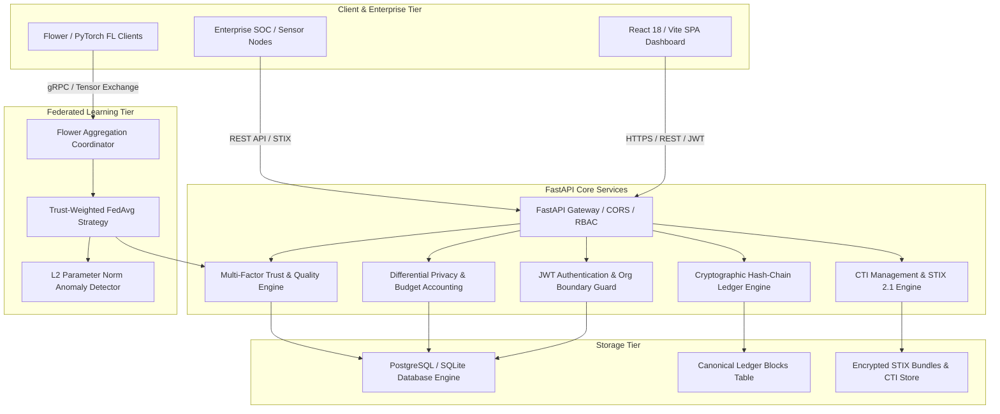
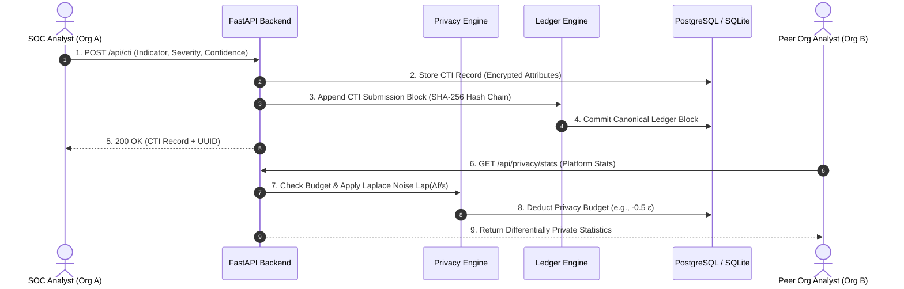
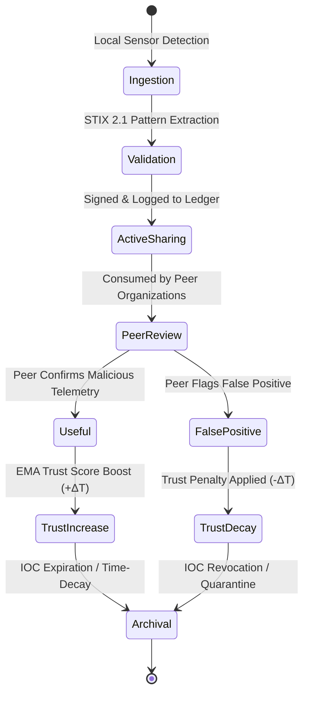
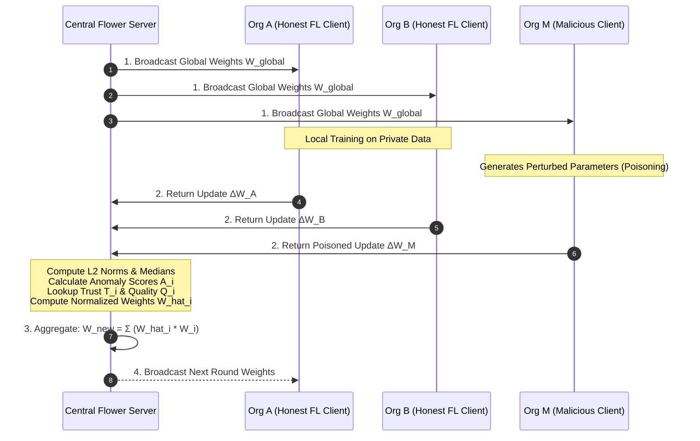
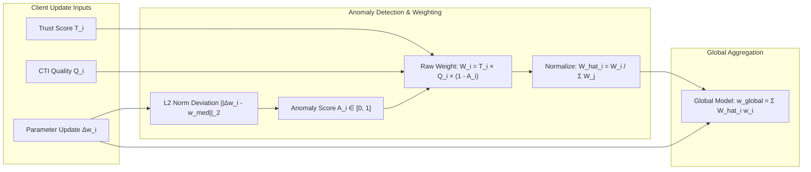
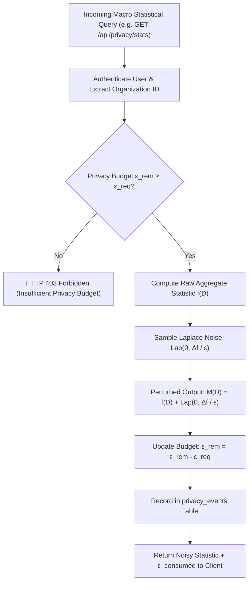
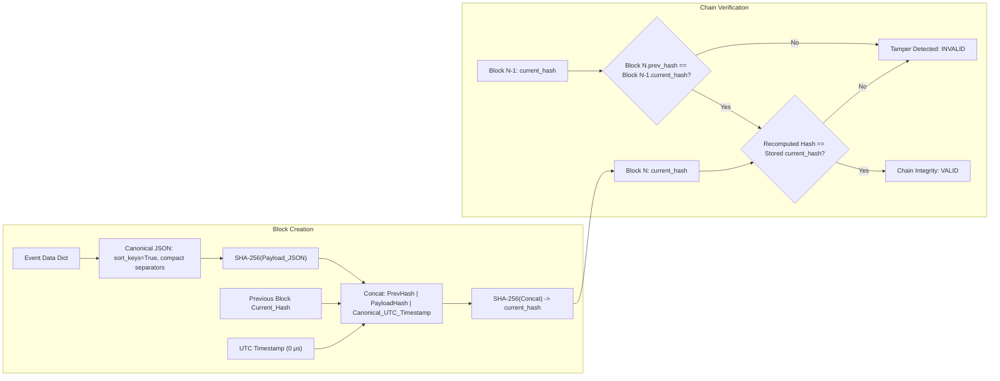
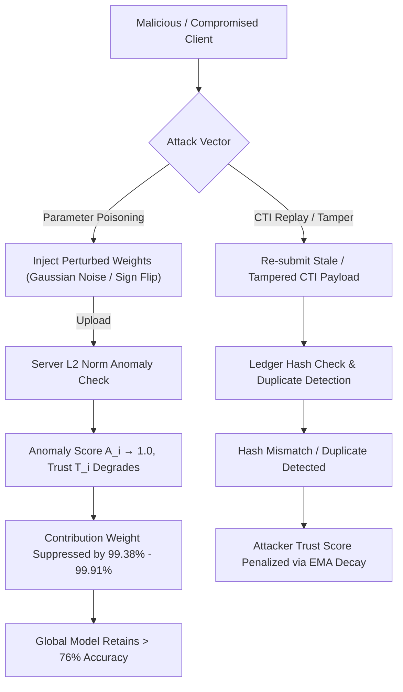
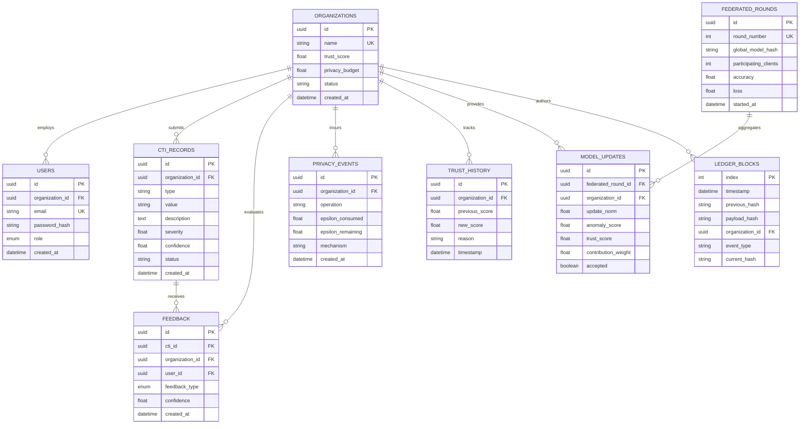
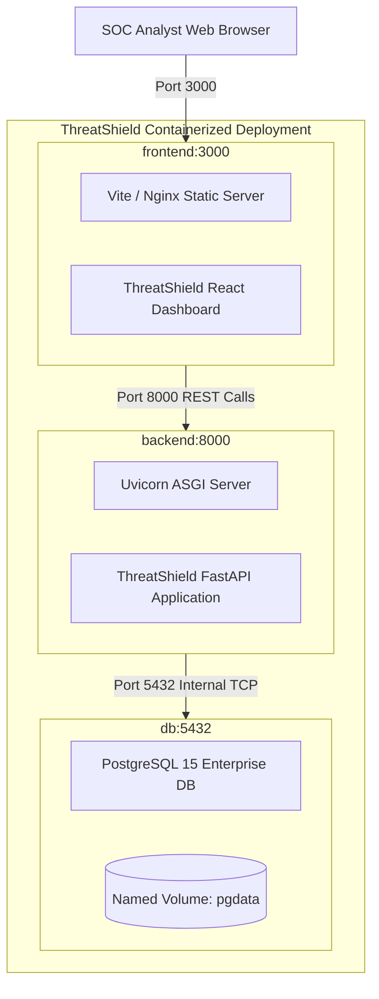

# THREATSHIELD — SYSTEM ARCHITECTURE DIAGRAMS

---

## 1. Overall System Architecture

---

## 2. Data Flow Architecture

---

## 3. CTI Lifecycle

---

## 4. Federated Learning Workflow

---

## 5. Trust-Weighted Aggregation Mechanism

---

## 6. Privacy Workflow (Differential Privacy & Budgeting)

---

## 7. Cryptographic Audit Ledger Workflow

---

## 8. Adversarial Attack & Defense Workflow

---

## 9. Database Entity-Relationship (ER) Diagram

---

## 10. Deployment Architecture

