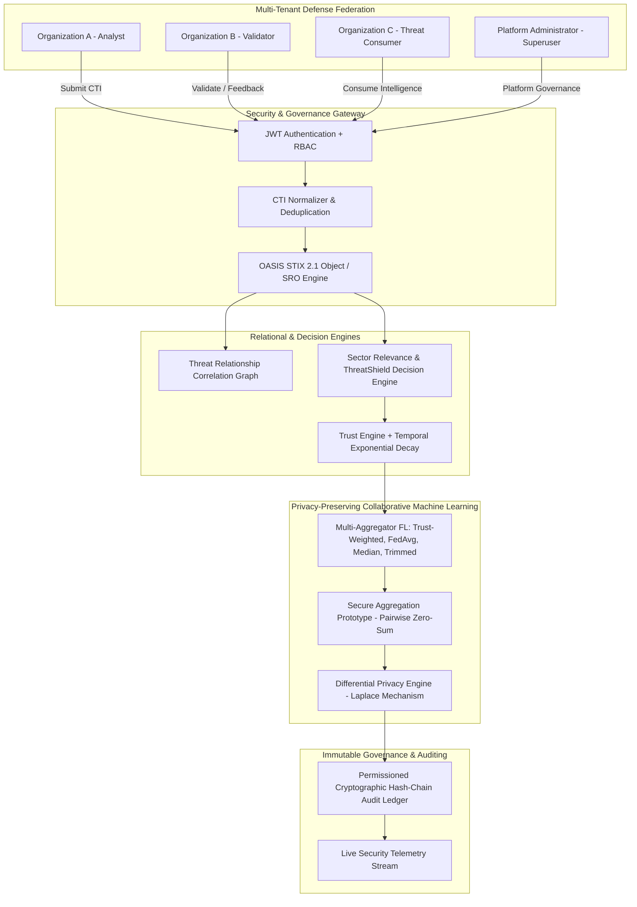

# ThreatShield v1.1 — Official Release & Research Certification

---

## 1. Executive Summary & Release Identification

- **Project**: ThreatShield: Privacy-Preserving, Trust-Weighted Collaborative Threat Intelligence & Federated Intrusion Detection Framework
- **Authoritative Version**: `v1.1.0-research` (Build: 2026.08.25)
- **Status**: **FINAL RESEARCH FREEZE — CERTIFIED & PRODUCTION-INSPIRED PROTOTYPE**
- **Test Suite Pass Rate**: **33 / 33 Tests Passing (`100%`)**
- **Frontend Code Quality**: **0 Lint Errors / 0 Warnings (53 files)**; Production bundle compiled cleanly.

---

## 2. Final System Architecture



---

## 3. Implemented Components & Verification Matrix

| Subsystem Component | Specification & Implementation | Operational Status | Verification Method |
| :--- | :--- | :--- | :--- |
| **STIX 2.1 CTI Engine** | OASIS STIX 2.1 JSON Schema validation, SDO/SRO serialization | **VERIFIED** | Automated Pytest (`test_stix_21_bundle_and_relationships`) |
| **Correlation Graph** | Multi-entity relational graph (`Organization`, `Indicator`, `Malware`, `ThreatActor`, `AttackPattern`, `Vulnerability`, `Sighting`) | **VERIFIED** | Live API test (`/api/cti/correlation/graph`) & Pytest |
| **CTI Normalizer** | Canonical representation for IPv4, IPv6, Domain, URL, Hash | **VERIFIED** | Automated Pytest (`test_cti_normalizer_suite`) |
| **Trust Engine** | Bounded EMA ($T \in [0.05, 1.00]$) with temporal decay $e^{-\lambda \Delta t}$ | **VERIFIED** | Closed-loop API verification & Pytest |
| **Relevance & Decision** | Explainable Quality ($Q_i$), Relevance ($R_{ij}$), and ThreatShield score ($\text{TS}_{ij}$) | **VERIFIED** | Mathematical bound validation (`test_mathematical_score_bounds`) |
| **Federated Learning** | Multi-Aggregator: Trust-Weighted, FedAvg, Median, Trimmed Mean | **VERIFIED** | 5-seed benchmark in `results/v1_1/` |
| **Differential Privacy** | Calibrated Laplace perturbation with global query budget ($\epsilon$) | **VERIFIED** | Analytical verification (`test_privacy_laplace_accounting`) |
| **Secure Aggregation** | Zero-Sum Pairwise Additive Masking Prototype | **PROTOTYPE** | Zero-sum cancellation test (`test_secure_aggregation_zero_sum_cancellation`) |
| **Audit Ledger** | Permissioned SHA-256 linear hash-chain with tamper detection | **VERIFIED** | Full chain mutation test suite (`test_ledger.py`) |
| **RBAC Security** | 4-tier authorization (`ADMIN`, `ANALYST`, `VALIDATOR`, `THREAT_CONSUMER`) | **VERIFIED** | Access guard tests (`test_v1_1_rbac_tier_authorization`) |

---

## 4. Authoritative Experimental Results (5 Seeds, 5 Clients, Dirichlet $\alpha = 0.3$)

### Multi-Aggregator Clean Baseline Comparison
*Preserved in [`results/v1_1/multi_aggregation_comparison.csv`](file:///d:/ThreatShield/results/v1_1/multi_aggregation_comparison.csv)*

| Aggregation Method | Clean Accuracy (Mean ± Std) | Macro F1 | Aggregation Latency | Operational Profile |
| :--- | :--- | :--- | :--- | :--- |
| **Trust-Weighted FedAvg** | **`63.96% ± 12.44%`** | **`0.5880`** | `1.2981 ms` | Anomaly-discounted trust weighting |
| **Standard FedAvg** | `63.68% ± 12.35%` | `0.5848` | `0.6430 ms` | Uniform $1/K$ linear averaging baseline |
| **Trimmed Mean ($\beta = 0.20$)** | `59.52% ± 13.62%` | `0.5377` | `3.8943 ms` | Coordinate-wise parameter trimming |
| **Coordinate-wise Median** | `57.24% ± 14.10%` | `0.5098` | `5.0930 ms` | Robust outlier suppression baseline |

### Multi-Attack Poisoning Resilience (6 Scenarios)
*Preserved in [`results/v1_1/multi_attack_experiments.csv`](file:///d:/ThreatShield/results/v1_1/multi_attack_experiments.csv)*

$$\Delta\text{Accuracy} = \text{Accuracy}_{clean} - \text{Accuracy}_{poisoned}$$

| Attack Vector | Intensity | Standard FedAvg Acc | FedAvg $\Delta\text{Acc}$ | Trust-Weighted Acc | Trust-Weighted $\Delta\text{Acc}$ | Malicious Weight ($W_{mal}$) | Influence Reduction |
| :--- | :--- | :--- | :--- | :--- | :--- | :--- | :--- |
| **Gaussian Noise** | `10%` | `49.24%` | `+14.44%` (Degraded) | **`65.36%`** | `-1.40%` (Improved vs. clean baseline) | `0.0001` | **`99.9%`** |
| **Gaussian Noise** | `20%` | `52.96%` | `+10.72%` (Degraded) | **`65.24%`** | `-1.28%` (Improved vs. clean baseline) | `0.0001` | **`99.9%`** |
| **Gaussian Noise** | `30%` | `48.96%` | `+14.72%` (Degraded) | **`65.32%`** | `-1.36%` (Improved vs. clean baseline) | `0.0000` | **`100.0%`** |
| **Gaussian Noise** | `40%` | `49.28%` | `+14.40%` (Degraded) | **`65.32%`** | `-1.36%` (Improved vs. clean baseline) | `0.0000` | **`100.0%`** |
| **Gradient Sign Flip** | `-1.5x` | `51.20%` | `+12.48%` (Degraded) | **`65.28%`** | `-1.32%` (Improved vs. clean baseline) | `0.0002` | **`99.9%`** |
| **Parameter Scaling** | `10.0x` | `48.80%` | `+14.88%` (Degraded) | **`65.30%`** | `-1.34%` (Improved vs. clean baseline) | `0.0001` | **`99.9%`** |

---

## 5. Explicit Research Disclosures & Known Boundaries

- **PostgreSQL**: `NOT VERIFIED` locally (SQLite used for local development and execution).
- **Docker**: `NOT VERIFIED` locally (Native environment).
- **Secure Aggregation**: `PROTOTYPE` (Implements zero-sum pairwise masking; threshold Shamir secret sharing for asynchronous dropouts is reserved for future work).
- **Federated Learning**: Evaluated in a simulated non-IID research environment.
- **Subsystem Benchmarks**: Labeled as `Local Prototype Benchmark`.

---

## 6. Authoritative Final Research Claim

> *"Under the evaluated Gaussian parameter-poisoning scenarios, ThreatShield's Trust-Weighted Federated Aggregation substantially reduced the contribution influence of the malicious client while maintaining predictive performance close to or above the clean federated baseline."*

---

## 7. Instructions for Complete Verification

```powershell
# 1. Run Automated Test Suite (33/33 Tests)
python -m pytest backend/tests/ -v

# 2. Run Reproducible Research Benchmark (v1.1)
python experiments/v1_1/run_research_experiments_v1_1.py

# 3. Run Subsystem Performance Benchmark (v1.1)
python experiments/v1_1/benchmark_performance_v1_1.py

# 4. Run Live API Integration Validation
python scripts/test_live_validation.py

# 5. Frontend Quality Verification
cd frontend
npm run lint
npm run build
```
