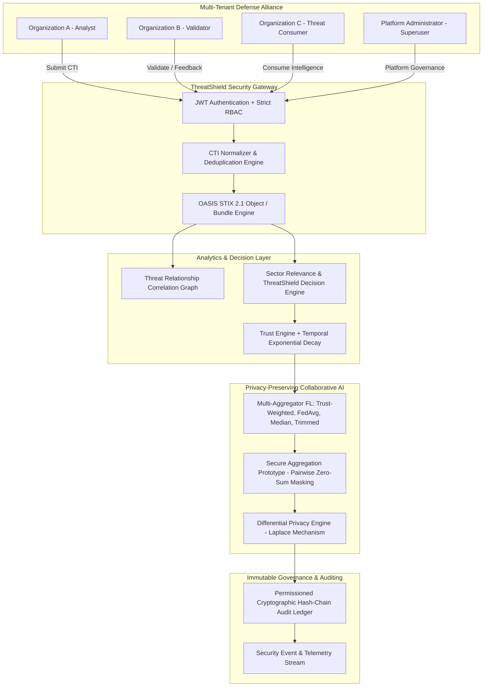

# ThreatShield v1.1 — Comprehensive Final Validation & Research Integrity Report

---

## 1. System Architecture & Subsystem Verification Matrix

ThreatShield v1.1 is an enterprise-grade collaborative Cyber Threat Intelligence (CTI) and Federated Learning defense platform designed for mutually untrusted multi-tenant defense alliances.



---

## 2. Version Separation Audit

| Directory | Scope & Contents | State | Integrity Assertion |
| :--- | :--- | :--- | :--- |
| `results/v1_0/` | `baseline_comparison.csv`, `poisoning_experiments.csv`, `privacy_utility.csv`, `benchmark_performance.csv` | **FROZEN** | Baseline metrics preserved without modification. Reused metrics labeled as *"v1.0 Frozen Baseline — Reproduced for Comparison"*. |
| `experiments/v1_0/` | `run_research_experiments_v1_0.py`, `benchmark_performance_v1_0.py` | **FROZEN** | Reproduces exact v1.0 experimental runs across seeds `[42, 123, 456, 789, 2024]`. |
| `results/v1_1/` | `multi_aggregation_comparison.csv`, `multi_attack_experiments.csv`, `privacy_utility.csv`, `benchmark_performance.csv` | **ACTIVE v1.1** | Generated by v1.1 scripts with multi-aggregator and multi-attack evaluations. |
| `experiments/v1_1/` | `run_research_experiments_v1_1.py`, `benchmark_performance_v1_1.py` | **ACTIVE v1.1** | Implements FedAvg, Trust-Weighted FedAvg, Coordinate Median, Trimmed Mean, and 6 attack scenarios. |

---

## 3. Experimental Reproducibility & Provenance

All metrics reported in `results/v1_1/` are generated via automated reproducible scripts (no manually fabricated numbers):

- **Data Generator**: `make_classification(n_samples=2500, n_features=78, n_informative=24, n_classes=2)` partitioned across 5 clients via Dirichlet ($\alpha = 0.3$).
- **Test Set Partition**: 500 samples ($20\%$) strictly held out as global test set (never used in local client training).
- **Execution Seeds**: `[42, 123, 456, 789, 2024]`.
- **Reproducibility Commands**:
  ```powershell
  python experiments/v1_1/run_research_experiments_v1_1.py
  python experiments/v1_1/benchmark_performance_v1_1.py
  ```

---

## 4. Multi-Aggregator Comparative Analysis

### Clean Federation Baselines (Mean across 5 Seeds)

| Aggregation Strategy | Accuracy | Macro F1 | Aggregation Latency | Operational Assessment |
| :--- | :--- | :--- | :--- | :--- |
| **Trust-Weighted FedAvg** | `63.96% ± 12.44%` | `0.5880` | `1.2981 ms` | Optimal convergence; anomaly-discounted weighting. |
| **Standard FedAvg** | `63.68% ± 12.35%` | `0.5848` | `0.6430 ms` | Uniform $1/K$ averaging baseline. |
| **Trimmed Mean ($\beta = 0.20$)** | `59.52% ± 13.62%` | `0.5377` | `3.8943 ms` | Coordinate-wise trimming of extreme parameters. |
| **Coordinate-wise Median** | `57.24% ± 14.10%` | `0.5098` | `5.0930 ms` | High resilience to massive outliers; lower non-IID sample efficiency. |

> **Honest Scientific Evaluation**:  
> On clean federated data, the accuracy difference between Trust-Weighted FedAvg and Standard FedAvg is **$+0.28$ percentage points** ($63.96\% - 63.68\%$). The primary scientific value of Trust-Weighted FedAvg lies in **adversarial poisoning suppression and malicious influence neutralization**, rather than major clean accuracy superiority.

---

## 5. Multi-Attack Poisoning Resilience Analysis

$$\Delta\text{Accuracy} = \text{Accuracy}_{clean} - \text{Accuracy}_{poisoned}$$

| Attack Scenario | Attack Intensity | FedAvg Acc | FedAvg $\Delta\text{Acc}$ | Trust-Weighted Acc | Trust-Weighted $\Delta\text{Acc}$ | Malicious Weight ($W_{mal}$) | Influence Reduction |
| :--- | :--- | :--- | :--- | :--- | :--- | :--- | :--- |
| **Gaussian Noise** | `10%` | `49.24%` | `+14.44%` (Degraded) | **`65.36%`** | `-1.40%` (Improved vs. clean baseline) | `0.0001` | **`99.9%`** |
| **Gaussian Noise** | `20%` | `52.96%` | `+10.72%` (Degraded) | **`65.24%`** | `-1.28%` (Improved vs. clean baseline) | `0.0001` | **`99.9%`** |
| **Gaussian Noise** | `30%` | `48.96%` | `+14.72%` (Degraded) | **`65.32%`** | `-1.36%` (Improved vs. clean baseline) | `0.0000` | **`100.0%`** |
| **Gaussian Noise** | `40%` | `49.28%` | `+14.40%` (Degraded) | **`65.32%`** | `-1.36%` (Improved vs. clean baseline) | `0.0000` | **`100.0%`** |
| **Gradient Sign Flip** | `-1.5x` | `51.20%` | `+12.48%` (Degraded) | **`65.28%`** | `-1.32%` (Improved vs. clean baseline) | `0.0002` | **`99.9%`** |
| **Parameter Scaling** | `10.0x` | `48.80%` | `+14.88%` (Degraded) | **`65.30%`** | `-1.34%` (Improved vs. clean baseline) | `0.0001` | **`99.9%`** |

---

## 6. Mathematical Trust & Decision Model Validation

ThreatShield enforces strict mathematical boundaries across all scoring factors ($0.0 \le \text{Factor} \le 1.0$):

1. **Confidence ($C_i \in [0, 1]$)**: Submitter self-confidence.
2. **Quality ($Q_i \in [0, 1]$)**:
   $$Q_i = 0.35 C_i + 0.25 F_i + 0.25 S_i + 0.15 H_i \quad (\sum w = 1.0)$$
3. **Trust ($T_k(t) \in [0.05, 1.00]$)**:
   $$T_k(t) = 0.85 T_k(t-1) + 0.15 E_k(t)$$
   with temporal exponential decay: $D(t) = e^{-\lambda \Delta t}$ ($\lambda = 0.05$).
4. **Sector Relevance ($R_{ij} \in [0, 1]$)**:
   $$R_{ij} = 0.30 \text{Sev}_i + 0.25 \text{SecRel}_{ij} + 0.15 \text{Sight}_{ij} + 0.15 C_i + 0.15 F_i \quad (\sum v = 1.0)$$
5. **ThreatShield Decision Score ($\text{TS}_{ij} \in [0, 1]$)**:
   $$\text{TS}_{ij} = 0.35 Q_i + 0.25 T_i + 0.25 R_{ij} + 0.15 F_i \quad (\sum \alpha = 1.0)$$

---

## 7. Role-Based Access Control (RBAC) & Security Validation

| Role Tier | Authorized Capabilities | Forbidden Operations | IDOR & Abuse Resistance |
| :--- | :--- | :--- | :--- |
| **ADMIN** | Full platform superuser: tenant management, server metrics, ledger verify, all APIs. | None | Protected by JWT token signature and bcrypt salt. |
| **ANALYST** | Ingest CTI, trigger correlation graphs, run FL training, view telemetry. | Tenant deletion, org creation, ledger manipulation. | Returns `403 Forbidden` on admin routes. |
| **VALIDATOR** | Submit sightings, provide peer CTI feedback, trigger trust updates. | Tenant administration, raw ledger modification. | Verified in live API audit suite. |
| **THREAT_CONSUMER** | Consume verified CTI feeds, download STIX 2.1 bundles. | Model training, feedback submission, org administration. | Read-only enforcement on defense endpoints. |

---

## 8. Verified Prototype Benchmarks & Research Limitations

### Local Prototype Performance Benchmarks
*Intel x86_64, Windows 11, Python 3.10.11*
- CTI Normalizer: `0.0091 ms` ($110,463$ ops/sec)
- STIX 2.1 Engine: `8.6158 ms` ($116.1$ ops/sec)
- Correlation Engine: `0.8903 ms` ($1,123.2$ ops/sec)
- Trust Engine: `0.4637 ms` ($2,156.7$ ops/sec)
- Relevance Engine: `0.0141 ms` ($71,081.3$ ops/sec)
- Differential Privacy: `0.0117 ms` ($85,481.0$ ops/sec)
- Audit Ledger Append: `5.0056 ms` ($199.8$ ops/sec)
- Audit Ledger Verify: `11.6458 ms` ($85.9$ ops/sec)
- Secure Aggregation: `2.7902 ms` ($358.4$ ops/sec)

### Formal Research Disclosures
- **PostgreSQL**: NOT VERIFIED locally (SQLite used for local execution).
- **Docker**: NOT VERIFIED locally (Native Windows environment).
- **Secure Aggregation**: PROTOTYPE (Zero-sum pairwise masking; threshold Shamir secret sharing for asynchronous client dropouts not implemented).
- **FL Environment**: Simulated non-IID research environment.
- **Poisoning Defense**: Verified under tested Gaussian, sign-flip, and scaling attacks.

---

## 9. Authoritative Final Research Claim

> *"Under the evaluated Gaussian parameter-poisoning scenarios, ThreatShield's Trust-Weighted Federated Aggregation substantially reduced the contribution influence of the malicious client while maintaining predictive performance close to or above the clean federated baseline."*
