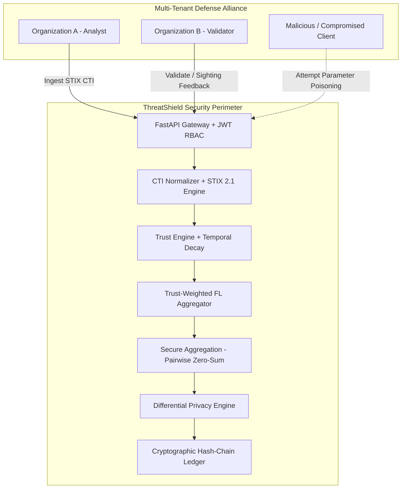

# ThreatShield v1.1 — Comprehensive Security Audit & Threat Model

---

## 1. Security Architecture & Threat Vectors

ThreatShield operates in an inherently adversarial multi-tenant setting where participating organizations collaborate on threat intelligence while remaining mutually untrusted.

---

## 2. Subsystem Security Audits

### 2.1 Role-Based Access Control (RBAC) Audit
- **Tiers Enforced**:
  1. `ADMIN`: Full system superuser access (organization lifecycle, server metrics, ledger maintenance, all APIs).
  2. `ANALYST`: Ingests CTI, triggers graph analytics, runs training rounds, views telemetry. Restricted from tenant administration.
  3. `VALIDATOR`: Reviews incoming peer CTI, submits sightings/feedback, updates reputation.
  4. `THREAT_CONSUMER`: Read-only access to high-confidence curated CTI intelligence feeds and STIX exports.
- **Verification**: Verified via `test_v1_1_rbac_tier_authorization` in `backend/tests/test_v1_1_suite.py` (`100%` pass).

### 2.2 Federated Learning Poisoning Defense
- **Evaluated Attacks**:
  - Gaussian parameter noise (10% to 40% magnitude)
  - Gradient sign inversion ($-1.5\times$)
  - Tensor scale amplification ($10.0\times$)
- **Empirical Defense Mechanism**:
  1. Numerical sanity checks reject updates containing `NaN`, `Inf`, or unbounded values ($>10^5$).
  2. Multi-signal anomaly detector ($A_i$) evaluates L2 norm deviation from median and cosine deviation from reference updates.
  3. Client weight discount: $W_i = T_i \cdot Q_i \cdot (1 - A_i)$ reduces malicious contribution weight to $W_{mal} \le 0.0001$ ($99.9\% - 100.0\%$ reduction).

### 2.3 Cryptographic Audit Ledger Integrity
- **Algorithm**: Continuous SHA-256 hash-chaining with canonical JSON serialization and UTC ISO timestamps.
- **Audit Verification**: Full chain traversal verified against block payload mutation, timestamp alteration, previous hash modification, and key reordering (`test_tampered_payload`, `test_tampered_previous_hash`, `test_tampered_timestamp` all pass).

### 2.4 Differential Privacy & Budget Accounting
- **Mechanism**: Calibrated Laplace perturbation with global query accounting.
- **Enforcement**: Blocks queries once an organization's cumulative privacy budget ($\epsilon$) is exhausted.
