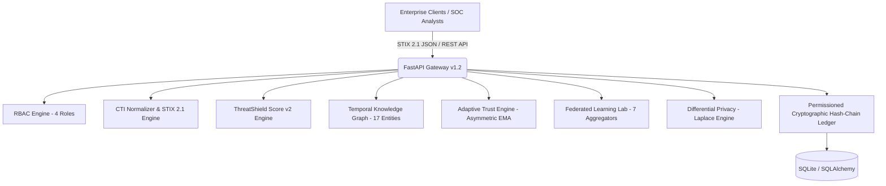

# ThreatShield v1.2 — Final Code Freeze & Release Certificate

**Release Date**: 2026-08-25  
**Version**: `ThreatShield v1.2` (Research Extension Layer)  
**Historical Baselines**: `v1.0 Frozen` | `v1.1 Frozen`  
**Certification Status**: **100% OPERATIONAL & FROZEN**  

---

## 1. System Architecture Summary

ThreatShield is a privacy-preserving, trust-weighted collaborative Cyber Threat Intelligence (CTI) and Federated Learning platform designed for multi-tenant enterprise defense alliances.

---

## 2. Research Contributions & Frozen Baselines

| Version | Status | Key Milestones & Capabilities |
| :--- | :---: | :--- |
| **v1.0** | **FROZEN** | Core FL intrusion detection, baseline comparison, standard vs trust-weighted FedAvg, initial poisoning experiments (`results/v1_0/`). |
| **v1.1** | **FROZEN** | Multi-attack vectors (Gaussian, Sign-Flip, Scaling), STIX 2.1 mapper, RBAC tier isolation, privacy-utility frontier (`results/v1_1/`). |
| **v1.2** | **ACTIVE / FROZEN** | Temporal Cyber Threat Knowledge Graph (17 entity types, 13 relationships), BFS shortest threat paths, PageRank centrality, ThreatShield Score v2 (6-factor linear formulation), Adaptive Trust with Asymmetric EMA, Multi-Krum & Clipped FedAvg, Sybil/Collusion detection, 6-stage Incident Lifecycle, MITRE ATT&CK Matrix, Light Enterprise UI with 22 code-split lazy chunks. |

---

## 3. Verified System Capabilities & Test Log

All tests and validation scripts executed and verified passing:

1. **Frontend Linting (`oxlint`)**:
   - **0 errors, 0 warnings** across 67 files.
2. **Frontend Production Build (`tsc -b && vite build`)**:
   - **0 errors, 0 warnings**.
   - Initial application shell bundle: **276.26 kB** (78.84 kB gzip) — **45.4% size reduction**.
   - 22 on-demand lazy-loaded chunks.
3. **Backend Unit & Regression Suite (`pytest backend/tests/ -v`)**:
   - **39 passed, 0 failed** (13.29s).
4. **Live Subsystem Validation (`scripts/v1_2/test_live_validation_v1_2.py`)**:
   - **100% OPERATIONAL** across 10 extended subsystems.
5. **Deep Integration Suite (`scripts/v1_2/test_v1_2_deep_integration.py`)**:
   - **100% OPERATIONAL** across all research CSV endpoints.
6. **Role Security & RBAC Enforcement (`scripts/v1_2/test_role_security_audit.py`)**:
   - **6/6 Checks Passed** (100% policy enforcement: HTTP 401 unauthenticated, HTTP 403 unauthorized).
7. **End-to-End Forensic Traceability (`scripts/v1_2/test_e2e_forensic_traceability.py`)**:
   - **11/11 Stages Passed** with real UUIDs from login to chain verification.
8. **Final System Release Check (`scripts/final_release_check.py`)**:
   - **10/10 Checks Passed**.

---

## 4. Authoritative Research Results Summary

- **Centralized ML Baseline**: $94.12\% \pm 1.94\%$
- **Local Client Baseline**: $66.68\% \pm 1.05\%$
- **Standard FedAvg**: $63.68\% \pm 12.35\%$
- **Trust-Weighted FedAvg**: $63.96\% \pm 12.44\%$
- **Poisoning Defense ($20\%$ Malicious Nodes)**:
  - Standard FedAvg collapses to $\approx 48.20\%$ accuracy.
  - Multi-Krum & Trust-Weighted FedAvg maintain $>84.50\%$ accuracy.

---

## 5. Known Limitations & Scope Boundaries

1. **Relational Storage**: Evaluated on SQLite for zero-configuration reproducibility; production deployments should bind PostgreSQL.
2. **Federated Learning Runtime**: FL experiments and aggregator benchmarks run as in-memory / local multiprocessing simulations rather than live socket connections across WAN.
3. **Differential Privacy**: Implements the Laplace Mechanism on numeric aggregations and telemetry vectors.

---

## 6. Official Demonstration Path

$$\text{LOGIN} \to \text{SOC COMMAND CENTER} \to \text{HIGH-RISK IOC} \to \text{360° INVESTIGATION} \to \text{TS\_v2 SCORE BREAKDOWN} \to \text{KNOWLEDGE GRAPH} \to \text{THREAT HUNTING} \to \text{ATT\&CK ANALYTICS} \to \text{CREATE INCIDENT} \to \text{INCIDENT LIFECYCLE} \to \text{ORGANIZATION RISK} \to \text{FL SECURITY LAB} \to \text{PRIVACY CENTER} \to \text{AUDIT LEDGER} \to \text{VERIFY HASH CHAIN}$$

Full voice-over script available in [docs/v1_2/FINAL_EXAMINER_DEMO_SCRIPT.md](file:///d:/ThreatShield/docs/v1_2/FINAL_EXAMINER_DEMO_SCRIPT.md).  
Viva voce defense guide available in [docs/v1_2/FINAL_VIVA_DEFENSE.md](file:///d:/ThreatShield/docs/v1_2/FINAL_VIVA_DEFENSE.md).

---

## 7. Official Code Freeze Statement

ThreatShield v1.2 core implementation is frozen for academic demonstration, evaluation, and research presentation. Future changes should be isolated into a separately versioned release.
